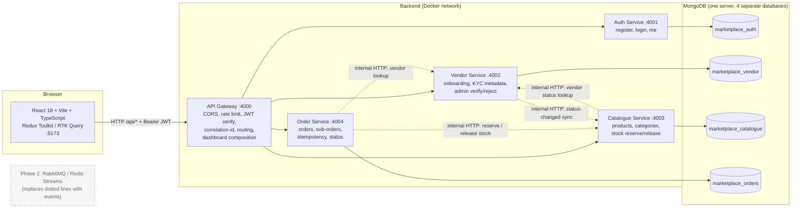
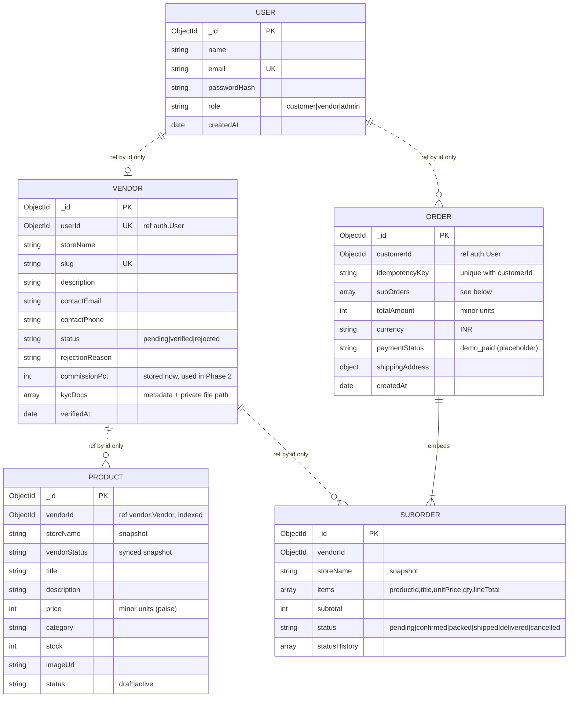
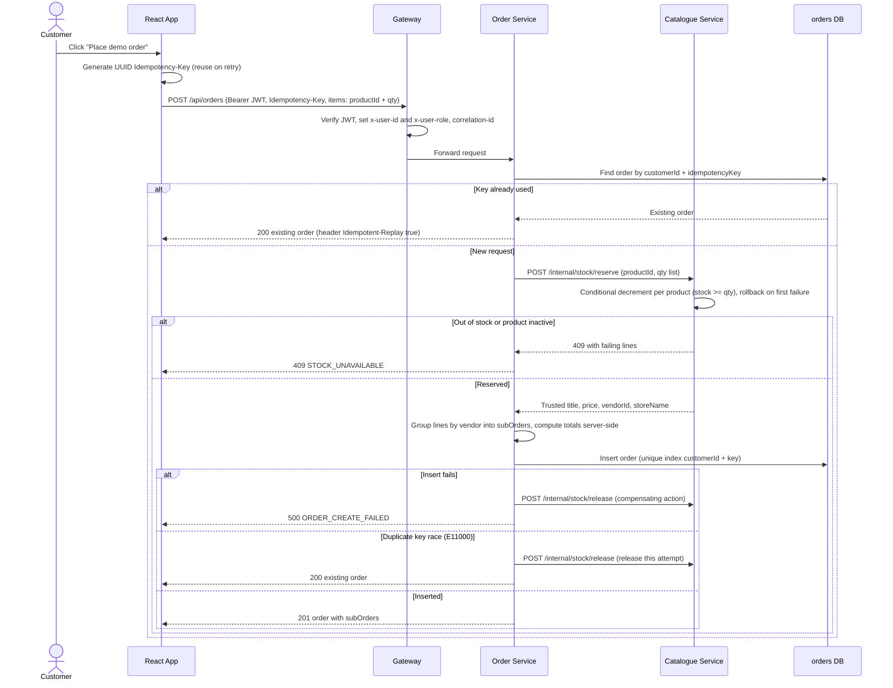
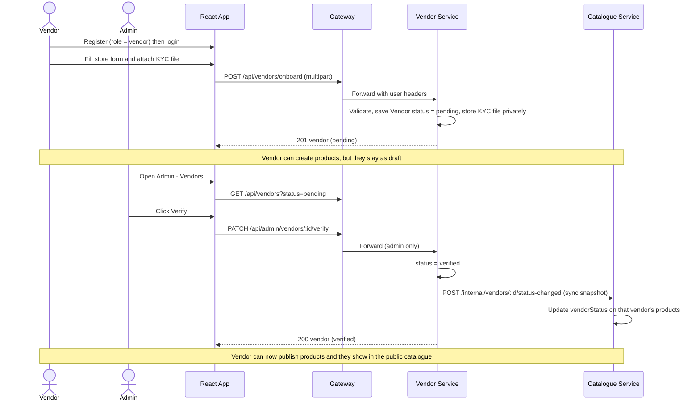
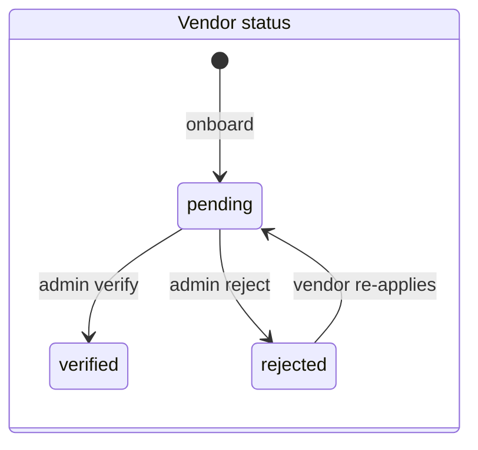
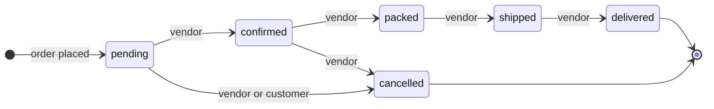
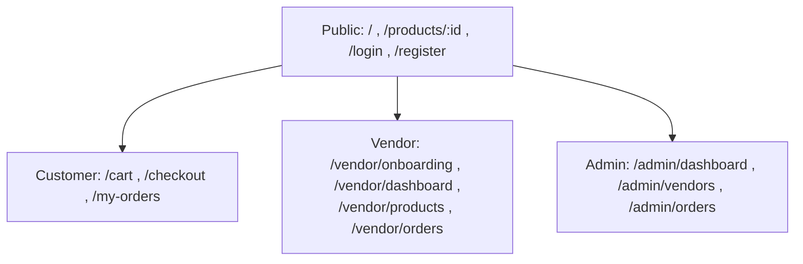
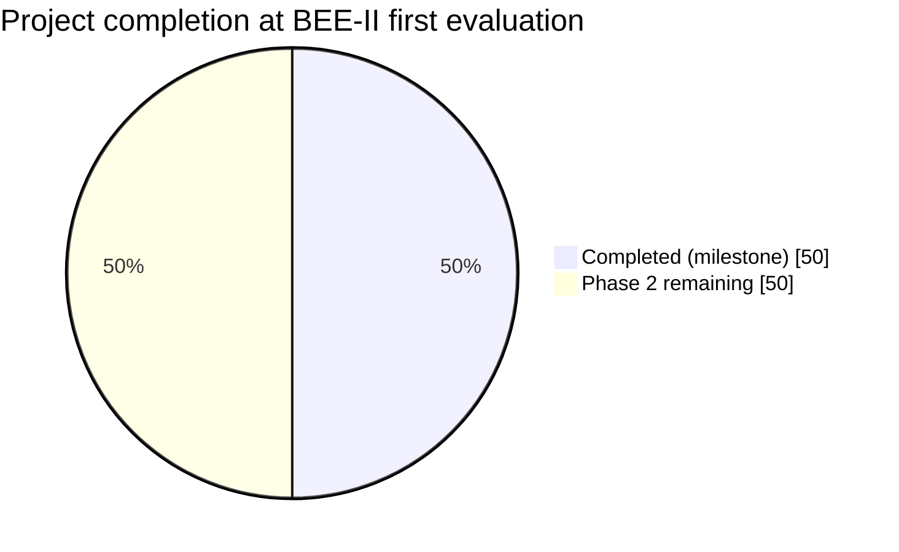

# Project 18 — Multi-Vendor Marketplace: BEE-II Mid-Evaluation Build Spec

> **How to use this file**
> 1. Create an empty project folder, `git init`, and save this file as `docs/BUILD_SPEC.md`.
> 2. Open the folder in Claude Code (use **Plan mode first**: press `Shift+Tab` until you see "plan mode").
> 3. Paste the **Launcher Prompt** below. Claude Code reads the rest of this file itself.
> 4. After every phase, check the gate, then say `continue`. Do not let it build everything in one go; phase-by-phase gives much better results.
> 5. Paste the Mermaid blocks into <https://mermaid.live> to get images for your PPT/report.

---

## PART 0 — LAUNCHER PROMPT (copy-paste this into Claude Code)

```text
You are a senior full-stack engineer. Read docs/BUILD_SPEC.md completely before doing anything.

Goal: build the BEE-II first-evaluation milestone (~50% of the project) of a
Multi-Vendor Marketplace with microservices, exactly as the spec describes.

Working rules:
1. Start with Phase 0: inspect the repo, then write a short plan to docs/PLAN.md.
2. Then execute phases P1 → P10 in order. After each phase: run the phase's
   verification commands, fix failures, and make one git commit
   ("feat(Pn): ..."). Then print a 5-line status and continue to the next phase
   unless a gate fails and you cannot fix it.
3. Create CLAUDE.md in the repo root from section "CLAUDE.md contents" of the spec
   so context survives long sessions.
4. Build real working code: real MongoDB, real REST calls, no hardcoded
   arrays in the UI, no fake dashboards, no decorative buttons.
5. Never claim something works unless you ran it. If a check cannot run in your
   environment, say so explicitly in docs/STATUS.md.
6. If you hit the context/time limit, follow the "Cut line" in the spec: drop
   items from the bottom of the list first, never the core flow.
7. Do not ask me questions unless you are completely blocked. State assumptions
   in docs/PLAN.md and proceed.
```

---

# PART 1 — CONTEXT (what the evaluator expects)

| Evaluator requirement | How this build satisfies it | Where to show it |
|---|---|---|
| ~50% project completion | Honest weighted progress table (Section 12) = **50%** | README + viva |
| Basic UI implementation | 14 responsive pages, Tailwind, loading/empty/error states | Live demo |
| Backend integration | React → API Gateway → 4 Express services → MongoDB | Live demo + network tab |
| Dynamic API data fetching | RTK Query, nothing hardcoded; seed data lives in MongoDB | Open DevTools → Network |

**Out of scope for this milestone (clearly labelled "Phase 2" in the UI/README):** real payments, Stripe Connect/Razorpay Route, commission settlement, vendor payouts, refunds/disputes, RabbitMQ/Redis event bus, transactional outbox, saga orchestrator, CI/CD, TLS, Kubernetes.

---

# PART 2 — ARCHITECTURE FIGURES

## Figure 1 — System architecture



**Rules:** dotted lines use an `x-internal-key` header and are not reachable from the public internet. No service reads another service's database. Only references by ID are stored across services.

## Figure 2 — Data model (one box per service database)



Money is always stored as **integer minor units (paise)**, never floats. This is required later for payouts and commission.

## Figure 3 — Checkout flow with idempotency and compensation (mini-saga)



## Figure 4 — Vendor onboarding and verification



## Figure 5 — State machines





Invalid transitions return `409 INVALID_STATUS_TRANSITION`. Cancelling a sub-order releases its stock back to the catalogue.

## Figure 6 — Page and role map



---

# PART 3 — TABLES (the contract Claude Code must follow)

## 3.1 Services, ports and responsibilities

| Process | Port | Database | Owns | Must NOT do |
|---|---|---|---|---|
| `frontend` | 5173 | — | UI only | Business logic, direct DB/service calls |
| `gateway` | 4000 | none | Routing, CORS, rate limit, JWT verify, correlation-id, dashboard composition | Store data |
| `auth-service` | 4001 | `marketplace_auth` | Users, password hashing, JWT issue | Know about vendors/products |
| `vendor-service` | 4002 | `marketplace_vendor` | Vendors, KYC metadata/files, verify/reject | Touch products or orders |
| `catalogue-service` | 4003 | `marketplace_catalogue` | Products, categories, stock reserve/release | Touch vendors/orders collections |
| `order-service` | 4004 | `marketplace_orders` | Orders, sub-orders, idempotency, status | Read product/vendor collections directly |
| `mongo` | 27017 | — | Four separate DBs on one container | — |

## 3.2 API contract

Auth column: `—` public, `JWT` any logged-in user, otherwise the role required.

| Method | Public path (via gateway) | Service | Auth | Notes |
|---|---|---|---|---|
| POST | `/api/auth/register` | auth | — | Role allowed: `customer` or `vendor` only. Admin can **never** self-register |
| POST | `/api/auth/login` | auth | — | Returns `{ token, user }` |
| GET | `/api/auth/me` | auth | JWT | |
| POST | `/api/vendors/onboard` | vendor | vendor | multipart: fields + `kycDoc` file; sets `pending` |
| GET | `/api/vendors/me` | vendor | vendor | Includes status + rejectionReason |
| GET | `/api/vendors` | vendor | — / admin | Public: verified only (safe fields). Admin: any `?status=` |
| GET | `/api/vendors/:id` | vendor | — | Verified vendors only, safe fields (no KYC) |
| GET | `/api/vendors/:id/kyc/:docId` | vendor | admin or owner | Streams private file. Never public |
| PATCH | `/api/admin/vendors/:id/verify` | vendor | admin | Triggers sync to catalogue |
| PATCH | `/api/admin/vendors/:id/reject` | vendor | admin | Body: `{ reason }` |
| GET | `/api/catalogue/products` | catalogue | — | `search, category, vendorId, page, limit, sort`. Only `active` + vendor `verified` |
| GET | `/api/catalogue/products/:id` | catalogue | — | 404 if not publicly visible |
| GET | `/api/catalogue/categories` | catalogue | — | Distinct categories with counts (aggregation) |
| GET | `/api/catalogue/my-products` | catalogue | vendor | Own products, any status, `search`, `status` filter |
| POST | `/api/catalogue/products` | catalogue | vendor | Unverified vendor: forced `draft`; `active` returns `403 VENDOR_NOT_VERIFIED` |
| PATCH | `/api/catalogue/products/:id` | catalogue | vendor | Ownership check |
| DELETE | `/api/catalogue/products/:id` | catalogue | vendor | Ownership check |
| POST | `/api/orders` | orders | customer | Header `Idempotency-Key` required (else `400`) |
| GET | `/api/orders/my-orders` | orders | customer | Paginated |
| GET | `/api/orders/:id` | orders | owner / admin | Vendors see only their sub-order via vendor route |
| GET | `/api/vendors/me/orders` | orders | vendor | **Gateway must route this BEFORE the generic `/api/vendors/*` rule** |
| PATCH | `/api/orders/:id/status` | orders | vendor | Body: `{ subOrderId, status }`; transition table enforced; own sub-order only |
| GET | `/api/admin/orders` | orders | admin | Paginated, `status` filter |
| GET | `/api/dashboard/customer` | gateway | customer | Composed from orders |
| GET | `/api/dashboard/vendor` | gateway | vendor | Composed from catalogue + orders + vendor |
| GET | `/api/dashboard/admin` | gateway | admin | Composed from auth + vendor + catalogue + orders stats |
| GET | `/health` | every service | — | `{ status, service, uptime, db }` |

**Internal-only endpoints** (require `x-internal-key`, blocked at the gateway):
`POST /internal/stock/reserve`, `POST /internal/stock/release`, `GET /internal/vendors/by-user/:userId`, `POST /internal/vendors/:id/status-changed`, and `GET /internal/stats` on every service (used by dashboard composition).

## 3.3 Permission matrix

| Action | Guest | Customer | Vendor (pending/rejected) | Vendor (verified) | Admin |
|---|:-:|:-:|:-:|:-:|:-:|
| Browse catalogue | ✅ | ✅ | ✅ | ✅ | ✅ |
| Place order | ❌ | ✅ | ❌ | ❌ | ❌ |
| Submit vendor application | ❌ | ❌ | ✅ | ✅ | ❌ |
| Create product as draft | ❌ | ❌ | ✅ | ✅ | ❌ |
| Publish product (`active`) | ❌ | ❌ | ❌ | ✅ | ❌ |
| Edit/delete own product | ❌ | ❌ | ✅ | ✅ | ❌ |
| Edit/delete someone else's product | ❌ | ❌ | ❌ | ❌ | ❌ |
| Update status of own sub-order | ❌ | ❌ | ❌ | ✅ | ❌ |
| Verify/reject vendors | ❌ | ❌ | ❌ | ❌ | ✅ |
| View KYC file | ❌ | ❌ | own only | own only | ✅ |
| View all orders / admin stats | ❌ | ❌ | ❌ | ❌ | ✅ |

## 3.4 Standard response formats

| Case | Shape |
|---|---|
| Success (single) | `{ "data": { ... } }` |
| Success (list) | `{ "data": [ ... ], "page": 1, "limit": 12, "total": 57 }` |
| Error | `{ "error": { "code": "VENDOR_NOT_VERIFIED", "message": "…", "details": [], "correlationId": "…" } }` |
| Status codes | `400` validation, `401` no/bad token, `403` wrong role/ownership, `404` not found, `409` conflict (stock, transition, duplicate), `429` rate limit, `500` unexpected |

## 3.5 Frontend pages

| Route | Role | Main data (RTK Query endpoint) | Key states |
|---|---|---|---|
| `/` | public | `getProducts`, `getCategories` | skeleton, empty, error + retry, pagination |
| `/products/:id` | public | `getProduct` | 404 page, out-of-stock badge |
| `/cart` | public | Redux cart slice (persisted in localStorage) | empty cart |
| `/checkout` | customer | `createOrder` (sends Idempotency-Key) | submitting, stock conflict, success toast |
| `/login`, `/register` | public | `login`, `register` | field validation, server errors |
| `/my-orders` | customer | `getMyOrders`, `getOrder` | empty, status badges |
| `/vendor/onboarding` | vendor | `onboardVendor`, `getMyVendor` | pending/rejected/verified banner |
| `/vendor/dashboard` | vendor | `getVendorDashboard` | metric cards, Recharts bar chart |
| `/vendor/products` | vendor | `getMyProducts`, create/update/delete | search, status badge, delete confirm modal |
| `/vendor/orders` | vendor | `getVendorOrders`, `updateSubOrderStatus` | only valid next-status buttons |
| `/admin/dashboard` | admin | `getAdminDashboard` | counts, recent orders table |
| `/admin/vendors` | admin | `getVendors`, `verifyVendor`, `rejectVendor` | pending tab, reject reason dialog |
| `/admin/orders` | admin | `getAdminOrders` | filter by status |

RTK Query **tags** to invalidate: `Product`, `MyProduct`, `Category`, `Vendor`, `Order`, `VendorOrder`, `Dashboard`. After create/update/delete product → invalidate `Product, MyProduct, Category, Dashboard`. After verify/reject → `Vendor, Dashboard`. After order create → `Order, Product, Dashboard`.

## 3.6 Environment variables

| Variable | Used by | Example (placeholder only) |
|---|---|---|
| `MONGO_URI_AUTH` / `_VENDOR` / `_CATALOGUE` / `_ORDERS` | each service | `mongodb://localhost:27017/marketplace_auth` |
| `JWT_SECRET` | auth, gateway | `change-me-dev-only` |
| `JWT_EXPIRES_IN` | auth | `1d` |
| `INTERNAL_API_KEY` | all services + gateway | `change-me-internal` |
| `AUTH_URL`, `VENDOR_URL`, `CATALOGUE_URL`, `ORDERS_URL` | gateway, services | `http://localhost:4001` … |
| `CORS_ORIGIN` | gateway | `http://localhost:5173` |
| `KYC_UPLOAD_DIR` | vendor | `./private_uploads` (git-ignored) |
| `SEED_DEMO_PASSWORD` | seed | `Demo@12345` (dev only) |
| `VITE_API_BASE_URL` | frontend | `http://localhost:4000/api` |

## 3.7 Repository structure (create exactly this)

```text
marketplace/
├─ CLAUDE.md                 # context file for Claude Code
├─ README.md
├─ docker-compose.yml
├─ .env.example              # placeholders only
├─ package.json              # npm workspaces: packages/*, services/*, frontend
├─ docs/  BUILD_SPEC.md  PLAN.md  STATUS.md  API.md  ARCHITECTURE.md
├─ packages/shared/          # logger (pino), correlationId middleware, AppError,
│                            # errorHandler, requireRole, internalClient, eventBus interface
├─ services/
│  ├─ gateway/               # src/{app,server,routes,middleware,dashboards}
│  ├─ auth-service/          # src/{app,server,config,models,routes,controllers,services,validators}
│  ├─ vendor-service/
│  ├─ catalogue-service/
│  └─ order-service/
├─ scripts/seed.js           # idempotent, deterministic ObjectIds
└─ frontend/                 # src/{app,store,api,components,features,pages,routes,lib}
```

Backend: Node 20, Express, **ESM**, Mongoose, `zod` validation, `pino` + `pino-http`, `helmet`, `express-rate-limit`, `multer`, `jsonwebtoken`, `bcryptjs`. Tests: Vitest + Supertest.

---

# PART 4 — PHASED BUILD PLAN (gate after each phase)

| Phase | Build | Gate (must pass before next phase) |
|---|---|---|
| **P0** | Inspect repo, write `docs/PLAN.md` (assumptions, risks) | Plan file exists |
| **P1** | Monorepo, `packages/shared`, gateway skeleton with proxy + correlation-id + health, Mongo in docker-compose | `docker compose up mongo` works; `GET :4000/health` OK |
| **P2** | Auth service + gateway JWT verification + `requireRole` | Register/login/me via gateway; customer cannot reach admin route (403) |
| **P3** | Vendor service: onboard, KYC upload (private), verify/reject, internal lookup | Vendor stays `pending`; admin verifies; KYC file not reachable publicly |
| **P4** | Catalogue service: public query + vendor CRUD + categories aggregation + reserve/release + status sync | Unverified vendor cannot publish; vendor B cannot edit vendor A's product |
| **P5** | Order service: idempotent create, grouping into sub-orders, status transitions, vendor orders, admin orders | Same key twice → one order; stock decrements once; invalid transition → 409 |
| **P6** | Gateway dashboard composition + `/internal/stats` | Three dashboard endpoints return values matching direct DB counts |
| **P7** | Frontend foundation: Vite+TS+Tailwind, RTK Query base API (`VITE_API_BASE_URL`), auth slice, route guards, layouts, toasts, 401/403 handling | `npm run build` passes; login works against gateway |
| **P8** | Customer pages: home, detail, cart, checkout, my-orders | Full buy flow works in browser |
| **P9** | Vendor pages + admin pages | Full vendor + admin flow works in browser |
| **P10** | Seed script, API tests, full Docker Compose, README/API docs, STATUS.md | Everything in Section 5 checklist verified for real |

**Cut line (if running out of time/context, drop from the bottom first):**
1. Docker-compose containers for all services (keep Mongo-only compose + `npm run dev`)
2. Recharts charts (keep metric cards)
3. Customer dashboard endpoint
4. KYC upload → fall back to metadata-only (document name + type + notes)
5. Category/vendor filters (keep search)

**Never cut:** auth + roles, product CRUD, public catalogue from DB, cart → order, sub-orders, idempotency, vendor verification, admin stats, seed script.

---

# PART 5 — BUSINESS RULES (do not deviate)

| # | Rule |
|---|---|
| R1 | Prices/totals are **always computed on the server** from catalogue data. Ignore any price sent by the client |
| R2 | Money = integer paise, currency `INR`. Format only in the UI |
| R3 | `Idempotency-Key` required on `POST /api/orders`; unique index `{customerId, idempotencyKey}`; replay returns the original order |
| R4 | Stock is reserved atomically per product with a conditional update (`stock >= qty`); multi-product reservation is all-or-nothing with rollback |
| R5 | Order creation failure after stock reservation → call `release` (compensating action) |
| R6 | Order lines are **snapshots** (title, price, store name) so later product edits/deletes don't change history |
| R7 | Public catalogue = `status: active` AND `vendorStatus: verified` |
| R8 | Vendors only ever see/modify their own products and sub-orders; enforce in the service, not just the UI |
| R9 | Payment is a **demo placeholder**: `paymentStatus: "demo_paid"`, UI label "Demo payment — no money moved". Put it behind a `PaymentProvider` interface (`DemoPaymentProvider` now; Stripe/Razorpay later) |
| R10 | KYC files are stored outside any static/public path and only streamed by an authorised endpoint |
| R11 | Every request carries `x-correlation-id` (generate if absent, propagate to internal calls, include in logs and error bodies) |
| R12 | No service imports another service's models. Cross-service data comes only through HTTP (now) or events (Phase 2) |
| R13 | Create `packages/shared/eventBus.js` with `publish(type, payload)` / `subscribe(type, handler)` and an in-process no-op implementation, so Phase 2 only swaps the implementation |

---

# PART 6 — SEED DATA (`scripts/seed.js`, idempotent)

Use deterministic ObjectIds and `bulkWrite` upserts keyed on natural keys (email, slug, product title+vendor) so reruns never duplicate. The seed script is a dev tool and is the only code allowed to write to several databases. Print the demo credentials at the end.

| Entity | Count | Details |
|---|---|---|
| Admin | 1 | `admin@demo.test` |
| Customers | 3 | `customer1@demo.test` … |
| Vendors | 3 | 2 `verified` (e.g. "TechNest", "Desi Threads"), 1 `pending` ("Green Basket") |
| Products | ≥ 12 | ≥ 4 categories, realistic INR prices, stock 0–50 (include one out-of-stock, one `draft`), image URLs |
| Orders | 5–6 | Multi-vendor orders with sub-orders in different statuses |

Password for all demo users: `SEED_DEMO_PASSWORD` (dev only).

---

# PART 7 — TESTS TO WRITE AND ACTUALLY RUN

| # | Test | Expected |
|---|---|---|
| T1 | Register with `role: admin` | Rejected (400/403) |
| T2 | Login wrong password | 401 |
| T3 | Customer calls `PATCH /api/admin/vendors/:id/verify` | 403 |
| T4 | Pending vendor creates product with `status: active` | 403 `VENDOR_NOT_VERIFIED` |
| T5 | Admin verifies vendor, vendor publishes product | Product appears in public catalogue |
| T6 | Vendor B edits vendor A's product | 403 |
| T7 | `POST /api/orders` without `Idempotency-Key` | 400 |
| T8 | Same `Idempotency-Key` sent twice | One order in DB, same body, stock decremented once |
| T9 | Order qty > stock | 409, stock unchanged |
| T10 | Client sends fake price | Ignored; total from DB price |
| T11 | Cart with 2 vendors | Order has 2 sub-orders with correct subtotals |
| T12 | Vendor A updates vendor B's sub-order | 403 |
| T13 | Invalid status jump (`pending` → `delivered`) | 409 |
| T14 | Cancel sub-order | Stock released |
| T15 | Admin dashboard counts | Equal direct DB counts |
| T16 | Seed run twice | No duplicate records |
| T17 | KYC URL requested without auth | 401/403 |
| T18 | `npm run build` in `frontend/` | Passes with no type errors |

`docs/STATUS.md` must list each test as ✅ run & passed, ❌ failed, or ⚪ not run (with reason). Never mark ✅ without running.

---

# PART 8 — FRONTEND REQUIREMENTS

- Layout: top navbar (brand, search, cart badge, account menu), sidebar for vendor/admin dashboards, footer with a "Phase 2 pending" note.
- Components: `ProductCard`, `StatCard`, `StatusBadge`, `DataTable`, `ConfirmDialog`, `EmptyState`, `ErrorState` (with retry), `Skeleton`, `Toast`.
- One colour system (e.g. indigo primary, slate neutrals), consistent spacing; minimal animation.
- Central `baseApi` using `fetchBaseQuery` with `VITE_API_BASE_URL`, token attached from the auth slice, global handling: `401` → logout + redirect to `/login`, `403` → "Not allowed" page/toast.
- Forms: client validation that mirrors server rules; server errors shown inline.
- **Never** fall back to hardcoded product arrays when a request fails; show `ErrorState`.
- Checkout page shows a visible banner: "Demo checkout — no real payment is processed."
- Generate the `Idempotency-Key` with `crypto.randomUUID()` when the checkout page opens; keep it until the order succeeds, so double-clicks/retries are safe.

---

# PART 9 — DOCUMENTATION DELIVERABLES

- `README.md`: overview, Figure 1 (Mermaid), prerequisites, setup, run commands, URLs, seed + demo accounts, tests, what's done vs pending.
- `docs/API.md`: every endpoint from 3.2 with a sample request/response (copy real outputs from running the system).
- `docs/ARCHITECTURE.md`: Figures 1–5 plus a paragraph on each design decision (why split, what got harder).
- `docs/STATUS.md`: test results (Part 7) + progress table (Part 12) + known bugs.
- `CLAUDE.md`: see next section.

---

# PART 10 — `CLAUDE.md` contents (create this file in the repo root)

```markdown
# Marketplace (BEE-II milestone)
Monorepo: frontend (React/Vite/TS), services/* (Express ESM), packages/shared.
Full spec: docs/BUILD_SPEC.md — re-read the relevant Part before each phase.

## Commands
- npm run dev:all  -> start gateway + 4 services + frontend (concurrently)
- docker compose up -d mongo
- npm run seed  -> idempotent seed
- npm test  -> Vitest + Supertest in each service
- cd frontend && npm run build

## Non-negotiables
- No service reads another service's DB. Cross-service = HTTP with x-internal-key.
- Money = integer paise. Server computes all totals.
- Orders require Idempotency-Key. Compensate (release stock) on failure.
- Public catalogue = active product AND verified vendor.
- Gateway route /api/vendors/me/orders must be declared before /api/vendors/*.
- Never claim a test passed without running it. Record results in docs/STATUS.md.
- Commit after every phase: feat(Pn): summary.
```

---

# PART 11 — LIVE DEMO SCRIPT (10 minutes with your teacher)

| Step | Action | What to say / show |
|---|---|---|
| 1 | Show Figure 1 (architecture) | "Gateway + 4 services, separate DBs, no shared collections" |
| 2 | Open `/` | DevTools → Network: products come from `GET /api/catalogue/products` (MongoDB) |
| 3 | Search + category filter | Query params go to the backend |
| 4 | Login as verified vendor → add/edit product | Refresh `/` and see the change |
| 5 | Register a new vendor → submit onboarding | Status shows **pending**; try publishing → blocked |
| 6 | Login as admin → approve | Vendor status changes; products become visible |
| 7 | Login as customer → add items from 2 vendors → checkout | Banner says demo payment |
| 8 | Show the order in customer, vendor, admin views | One order → two sub-orders |
| 9 | Click Place order twice quickly / replay request | Only one order created (idempotency) |
| 10 | Show Part 12 progress table + pending list | Honest 50 percent |

## Likely viva questions (prepare these)

| Question | Short answer |
|---|---|
| Why microservices here? | Independent ownership of auth/vendor/catalogue/orders; payments will be added as separate service. Cost: network calls, no joins, eventual consistency |
| How do you avoid duplicate orders? | Idempotency-Key + unique index `{customerId, key}`; replay returns the same order |
| What if order insert fails after reserving stock? | Compensating `release` call (basic saga idea; full saga in Phase 2) |
| Why store `storeName` in product? | No cross-DB joins; snapshot denormalisation kept in sync via status-changed call |
| Why paise integers? | Avoid floating-point errors in money/commission |
| What is not done? | Payments, commission, payouts, refunds, message broker, outbox, CI/CD, TLS |

---

# PART 12 — HONEST PROGRESS TABLE (weights sum to 100)

| Work package | Weight | Done at this milestone | Notes |
|---|--:|--:|---|
| Foundation (monorepo, gateway, logging, Docker Mongo) | 8 | 8 | |
| Auth and roles | 6 | 6 | |
| Catalogue + vendor product management | 10 | 10 | |
| Vendor onboarding + admin verification | 8 | 6 | KYC upload basic; no document review tools |
| Cart, checkout, orders, sub-orders, idempotency | 12 | 9 | Demo payment only |
| Dashboards (customer/vendor/admin) | 8 | 7 | |
| Event bus + transactional outbox | 10 | 1 | Interface only |
| Payments / split payments / commission | 12 | 0 | Phase 2 |
| Payout settlement jobs | 10 | 0 | Phase 2 |
| Returns, refunds, disputes | 6 | 0 | Phase 2 |
| Saga orchestration / full compensation | 4 | 1 | Stock release only |
| CI/CD, TLS, full deployment, observability | 6 | 2 | Docker compose only |
| **Total** | **100** | **50** | |



**Phase 2 roadmap:** RabbitMQ/Redis Streams → outbox pattern → payment service (Razorpay Route/Stripe Connect) → commission rules → scheduled payouts → refunds/adjustments → saga for order-payment-stock → CI/CD + Nginx TLS → distributed tracing.

---

# PART 13 — FINAL OUTPUT CLAUDE CODE MUST PRINT WHEN DONE

1. What was implemented (short).
2. Actual file tree.
3. Exact commands to start everything + URLs (frontend `:5173`, gateway `:4000`).
4. Demo credentials created by the seed.
5. Which APIs/tests were really run (with results) and which were not.
6. Known bugs/limitations.
7. Completed / partial / not-started table.
8. Next steps toward the full project.
