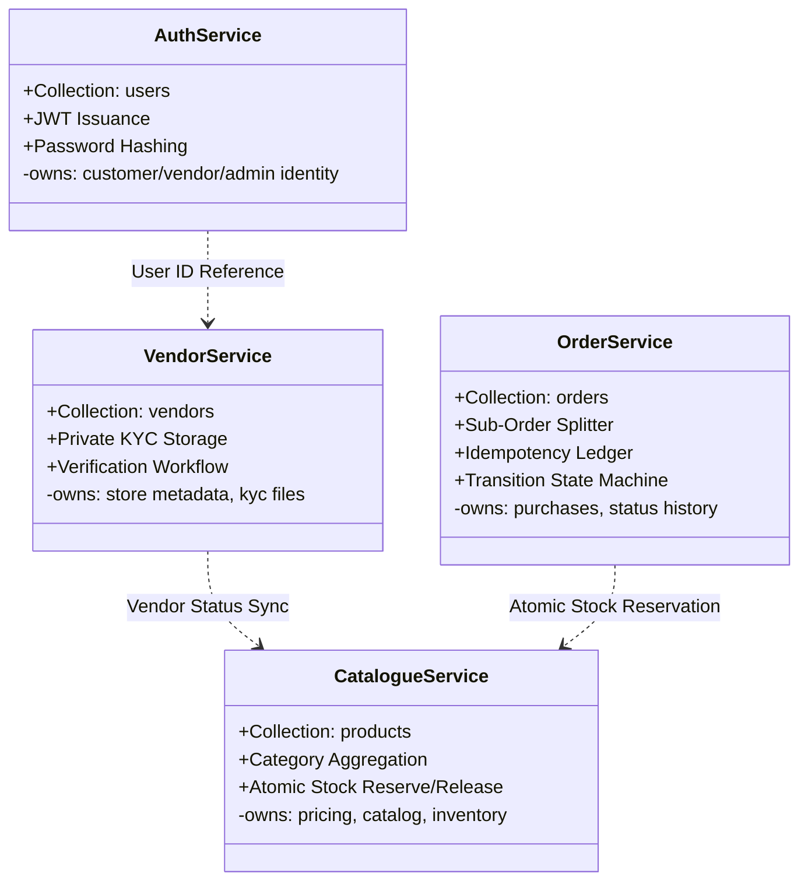
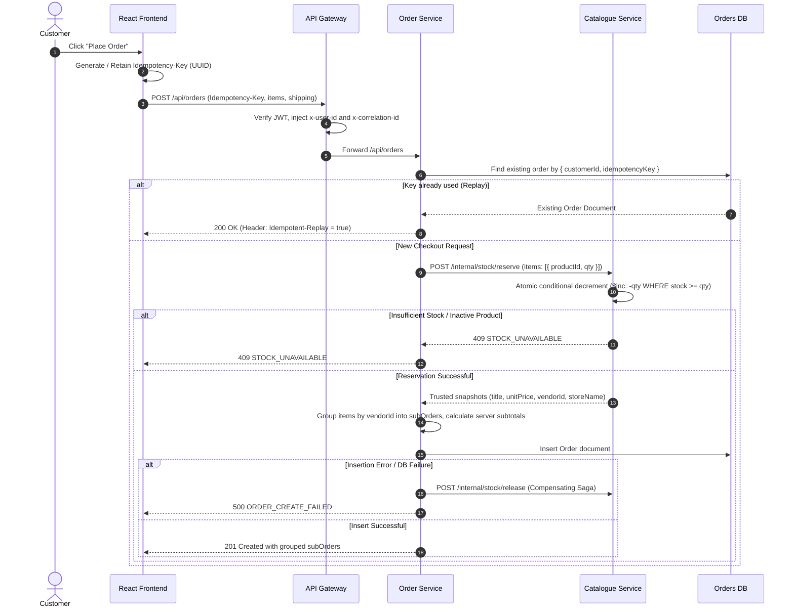
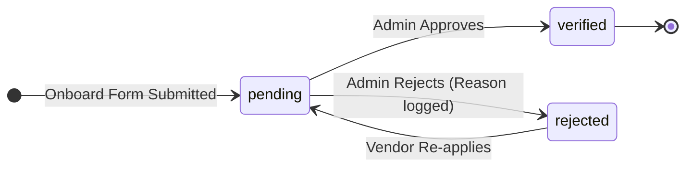
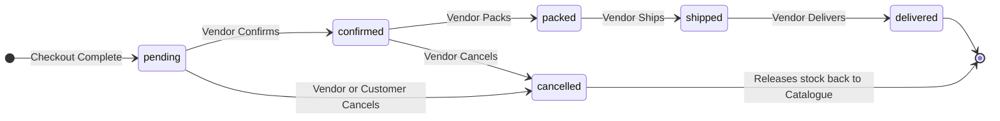

# System Architecture & Design Rationale

This document details the architectural topology, sequence flows, state machines, and design trade-offs implemented in the Multi-Vendor Marketplace platform for the BEE-II Mid-Evaluation milestone.

---

## 1. System Topology & Request Routing (Figure 1)

```mermaid
flowchart TB
  subgraph Client Tier
    FE["React 18 + TS + Tailwind<br/>(Port 5173)"]
  end

  subgraph Gateway Tier
    GW["API Gateway<br/>Express Reverse Proxy<br/>(Port 4000)"]
  end

  subgraph Microservices Tier
    AUTH["Auth Service<br/>(Port 4001)"]
    VEN["Vendor Service<br/>(Port 4002)"]
    CAT["Catalogue Service<br/>(Port 4003)"]
    ORD["Order Service<br/>(Port 4004)"]
  end

  subgraph Data Persistence Tier (MongoDB 27017)
    DB_AUTH[("marketplace_auth")]
    DB_VEN[("marketplace_vendor")]
    DB_CAT[("marketplace_catalogue")]
    DB_ORD[("marketplace_orders")]
  end

  FE -->|Public REST Requests| GW
  GW -->|Proxy /api/auth/*| AUTH
  GW -->|Proxy /api/vendors/*| VEN
  GW -->|Proxy /api/catalogue/* & /api/products/*| CAT
  GW -->|Proxy /api/orders/* & /api/vendors/me/orders| ORD

  AUTH --> DB_AUTH
  VEN --> DB_VEN
  CAT --> DB_CAT
  ORD --> DB_ORD

  ORD -.->|Internal HTTP: /internal/stock/reserve & release| CAT
  VEN -.->|Internal HTTP: /internal/vendors/:id/status-changed| CAT
  GW -.->|Internal HTTP: /internal/stats| AUTH & VEN & CAT & ORD
```

---

## 2. Service Domain Boundaries & Data Ownership (Figure 2)



---

## 3. Idempotent Checkout & Stock Reservation Flow (Figure 3)



---

## 4. Vendor Onboarding & KYC Verification Workflow (Figure 4)

```mermaid
sequenceDiagram
  autonumber
  actor V as Vendor
  actor A as Admin
  participant FE as Frontend Portal
  participant GW as Gateway
  participant VEN as Vendor Service
  participant CAT as Catalogue Service

  V->>FE: Fill onboarding form & upload KYC file
  FE->>GW: POST /api/vendors/onboard (multipart/form-data)
  GW->>VEN: Proxy onboarding request
  VEN->>VEN: Store file in private_uploads (non-public), set status = pending
  VEN-->>FE: 201 Vendor Profile Created (Pending)
  Note over V,CAT: Vendor can draft products, but publishing active products is blocked (403)

  A->>FE: Review Pending Applications in Admin Portal
  FE->>GW: PATCH /api/admin/vendors/:id/verify
  GW->>VEN: Proxy verification request
  VEN->>VEN: Set vendor status = verified, record verifiedAt
  VEN->>CAT: POST /internal/vendors/:id/status-changed (Push Event)
  CAT->>CAT: Update vendorStatus = verified on all vendor products
  VEN-->>FE: 200 Vendor Verified
  Note over V,CAT: Vendor can now publish active products; catalogue search shows items immediately
```

---

## 5. State Transition Machines (Figure 5)

### 5.1 Vendor Status Lifecycle


### 5.2 Sub-Order Fulfillment Lifecycle


---

## 6. Architectural Decisions & Engineering Trade-Offs

### 6.1 Why Split into Microservices?
- **Domain Independence**: Auth, Vendor KYC, Product Catalog, and Order Processing change at completely different cadences.
- **Security Boundaries**: Vendor KYC files must never be publicly accessible or colocated with public product images. By isolating Vendor Service into its own process, file upload directories are sealed and served only through strict authorization streaming endpoints.
- **Independent Failure Domains**: A spike in catalogue search queries or high browsing traffic does not prevent order processing or authentication.

### 6.2 Why Separate Databases per Service?
The design strictly adheres to the **Database-per-Service** pattern (`marketplace_auth`, `marketplace_vendor`, `marketplace_catalogue`, `marketplace_orders`). No service is permitted to perform cross-database queries or import Mongoose models belonging to another domain.
- *Advantage*: Prevents tight coupling and hidden relational schemas that undermine scalability.
- *Trade-off*: Joins are not possible at the database level. Aggregations (such as Admin Dashboards or Multi-Vendor Orders) must be composed via API Gateway or internal HTTP orchestration.

### 6.3 Distributed Transactions vs Saga Pattern
In a monolithic system, reserving stock and saving an order is wrapped in an ACID database transaction. Across microservices, two-phase commit (2PC) is brittle and introduces blocking latency.
- *Our Solution*: We implemented a **Compensating Transaction (Mini-Saga)**.
  1. Order Service calls Catalogue Service `POST /internal/stock/reserve`.
  2. Catalogue performs atomic conditional decrements (`$inc: -qty WHERE stock >= qty`). If any item lacks stock, it immediately rolls back previously reserved lines in the batch and returns 409.
  3. If Order Service fails to insert the order document, it invokes `POST /internal/stock/release` to restore inventory.
  4. If an order is later cancelled, the sub-order cancellation handler triggers the same release endpoint to restore stock.

### 6.4 Monetary Representation (Integer Paise)
- Floating-point representations (`19.99`) cause catastrophic precision drift due to IEEE 754 binary arithmetic errors.
- All monetary values are strictly represented and calculated as integer paise (`INR 100.00` = `10000` paise).
- Monetary totals are computed exclusively server-side from catalogue database snapshots; any price sent by the client is discarded.

### 6.5 Idempotency via Compound Unique Indexes
- Network retries and impatient user double-clicks can easily generate duplicate charges or orders.
- Order Service enforces a compound unique index `{ customerId: 1, idempotencyKey: 1 }`.
- When an order request arrives with an existing key, the service detects the record and returns the existing order with the `Idempotent-Replay: true` header without re-decrementing stock.
